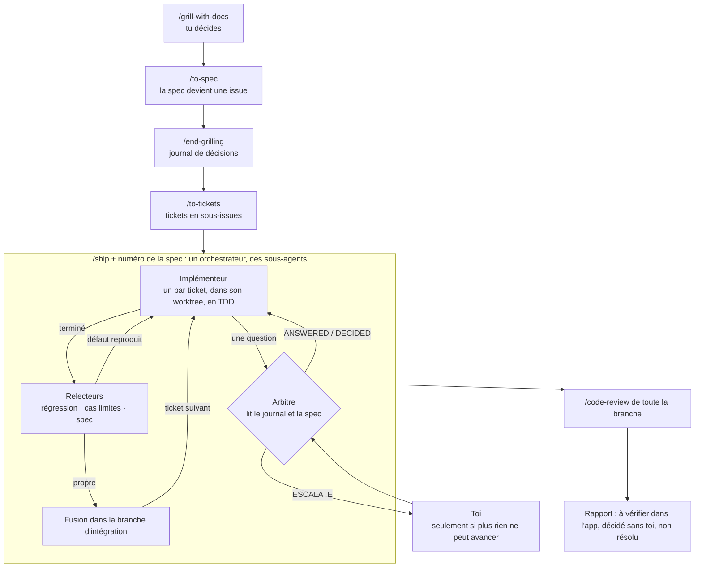

# skills

Skills Claude Code personnels, installables avec [`npx skills`](https://github.com/vercel-labs/skills).

| Skill | Description |
| --- | --- |
| `end-grilling` | Clôt une session de grilling : écrit chaque décision de l'humain, avec ses propres mots, dans le journal de décisions (hors du repo). |
| `ship` | Livre les tickets d'une spec sur une branche d'intégration : chaque ticket implémenté, revu jusqu'à être propre, puis mergé. |

## Pourquoi ces deux skills

Ils complètent ceux de [Matt Pocock](https://github.com/mattpocock/skills), qui couvrent déjà le grilling, la spec et les tickets. Il manquait la livraison sans surveillance : laissé seul, un agent qui implémente revient poser des questions auxquelles l'humain a déjà répondu pendant le grilling, ou qui relèvent de l'implémentation.

- **`end-grilling`** garde ces réponses. La spec dit ce qui a été décidé ; le **journal de décisions** garde aussi comment ça a été dit, ce qui a été refusé et pourquoi, et ce qui a été repoussé hors périmètre.
- **`ship`** livre la spec en autonomie. Quand un agent pose une question, un **arbitre** y répond à partir du journal et de la spec, à la place de l'humain. Seules les questions que rien ne tranche remontent.

## Le flux



`/grill-with-docs`, `/to-spec`, `/to-tickets`, `/tdd` et `/code-review` sont les skills de Matt Pocock ; `/end-grilling` et `/ship` sont ceux de ce dépôt.

## Comment ils marchent

### `end-grilling`

À lancer à la fin du grilling, après `/to-spec`.

1. Il relit la conversation (ou une session passée, extraite par `extract-turns.py`).
2. Il écrit une entrée par décision : ce qui était demandé, la réponse mot pour mot, ce à quoi elle engage, la section de la spec concernée.
3. Il montre les décisions absentes de la spec et les contradictions, et corrige la spec si tu acceptes.

Le journal ne se réécrit jamais : une décision qui en remplace une autre s'ajoute, et l'ancienne est marquée comme remplacée.

### `ship`

Il se lance avec le numéro de l'issue de la spec : `/ship 47`. Tout le reste s'en déduit : les tickets sont les sous-issues de la 47, le journal est `decisions/47.md`, la branche d'intégration `ship/47`, les branches de tickets `ship/47-<ticket>`.

L'orchestrateur ne code pas et ne lit aucun diff : il distribue le travail et route les rapports.

| Rôle | Ce qu'il fait |
| --- | --- |
| Implémenteur | Un par ticket, dans son propre worktree, avec `/tdd`. Il tranche seul les choix d'implémentation et les liste. |
| Arbitre | Répond aux questions comme l'humain l'a déjà fait. Il ne fait remonter une question que si elle se pose sans parler de code, si la réponse se remarquerait, et si rien de ce qui a été dit ne la tranche. |
| Relecteurs | Trois par ticket, un par angle : régression, cas limites, conformité à la spec. Un défaut ne bloque que s'il a été reproduit. Trois tours au plus. |
| Fusionneur | Fusionne le ticket propre dans la branche d'intégration et relance la vérification. |
| Vérificateur | Charge dans un vrai navigateur ce qui a changé à l'écran, dans le bac à sable. |

Rien n'est jamais committé sur la branche principale. À la fin, un seul message : les questions restées ouvertes, ce qu'il faut regarder de tes yeux, ce qui a été décidé sans toi, ce qui n'est pas résolu.

Fichiers du skill : `SKILL.md` (l'orchestrateur), `arbiter.md`, `reviewers.md`, `delivery-template.md`.

## Ce qu'ils attendent d'un projet

- **Une spec publiée en issue**, et ses tickets en sous-issues (`/to-spec`, `/to-tickets`).
- **`docs/agents/delivery.md`** : les règles de livraison du projet (commande de vérification, bac à sable, données et services interdits, style des commits). `ship` l'écrit au premier lancement à partir de `delivery-template.md`. Ce fichier ne nomme ni spec, ni ticket, ni branche : il vaut pour toutes les livraisons et ne se réécrit pas d'une spec à l'autre.
- **Les skills `tdd`, `code-review` et `to-spec`** installés.

## Où vivent les choses

| Quoi | Où | Pourquoi |
| --- | --- | --- |
| Spec, tickets | Le suivi d'issues | Datés, fermés une fois livrés, hors du contexte des agents |
| Journal de décisions | `~/.local/share/ship/<dépôt>/decisions/<n>.md`, `<n>` étant le numéro de l'issue de la spec | Il ne sert qu'à l'arbitre, le temps d'une livraison ; un seul exemplaire, lisible depuis tous les worktrees |
| Registre de `ship` (état des tickets, verdicts) | `~/.local/share/ship/<dépôt>/ledger/<n>.md` | Pour reprendre après une compaction ou un plantage ; `/tmp` est vidé au démarrage |
| Branches d'une livraison | `ship/<n>` et `ship/<n>-<ticket>` | Nommées par la spec, donc rien à choisir |
| Règles de livraison, glossaire, ADR | Le dépôt | Ils décrivent le présent ou expliquent un choix durable |

Aucun de ces emplacements ne se règle par projet : c'est la même convention partout.

## Quand ne pas les utiliser

- **Un petit changement, un seul ticket.** `ship` lance un implémenteur et jusqu'à trois relecteurs par ticket : c'est bien plus cher que le changement lui-même. Fais-le directement, ou avec `/implement`.
- **Pas de grilling, donc pas de journal.** L'arbitre n'aurait rien pour répondre à ta place : il déciderait à l'aveugle ou te ferait tout remonter.
- **Un besoin encore flou.** `ship` exécute une spec, il ne cherche pas le chemin. Pour explorer : `/prototype` ou `/wayfinder`.
- **Ce qui se juge à l'œil** : l'allure d'une page, un vrai téléphone, de vraies données. `ship` le range dans « à vérifier dans l'app », il ne le valide pas.
- **Un projet sans commande de vérification ni bac à sable.** Les relecteurs ne bloquent que sur un défaut reproduit ; sans moyen de lancer le produit en sécurité, ils ne reproduisent rien.
- **Si tu veux relire chaque diff au fil de l'eau.** Le principe est inverse : tu relis la branche d'intégration à la fin.
- **À plusieurs, ou depuis une session cloud.** Le journal et le registre sont sur ta machine : un collègue ou une session distante ne les a pas.

## Installation

Le repo est privé : `npx skills` le clone via git, donc il faut être authentifié auprès de GitHub (`gh auth login` / `gh auth setup-git`).

```bash
# Tous les skills, au niveau utilisateur
npx skills add Schrubitteflau/skills -g

# Un seul skill
npx skills add Schrubitteflau/skills -g --skill ship
```

Mise à jour :

```bash
npx skills update -g
```

## Modifier un skill

Ce dépôt est la source de vérité. Modifier ici, pousser, puis lancer `npx skills update -g`. Ne rien éditer dans `~/.claude/skills/` ni `~/.agents/skills/` : la prochaine mise à jour l'écraserait.

## Ajouter un skill

Créer `skills/<nom>/SKILL.md` (frontmatter `name` + `description`) avec ses fichiers annexes à côté.
