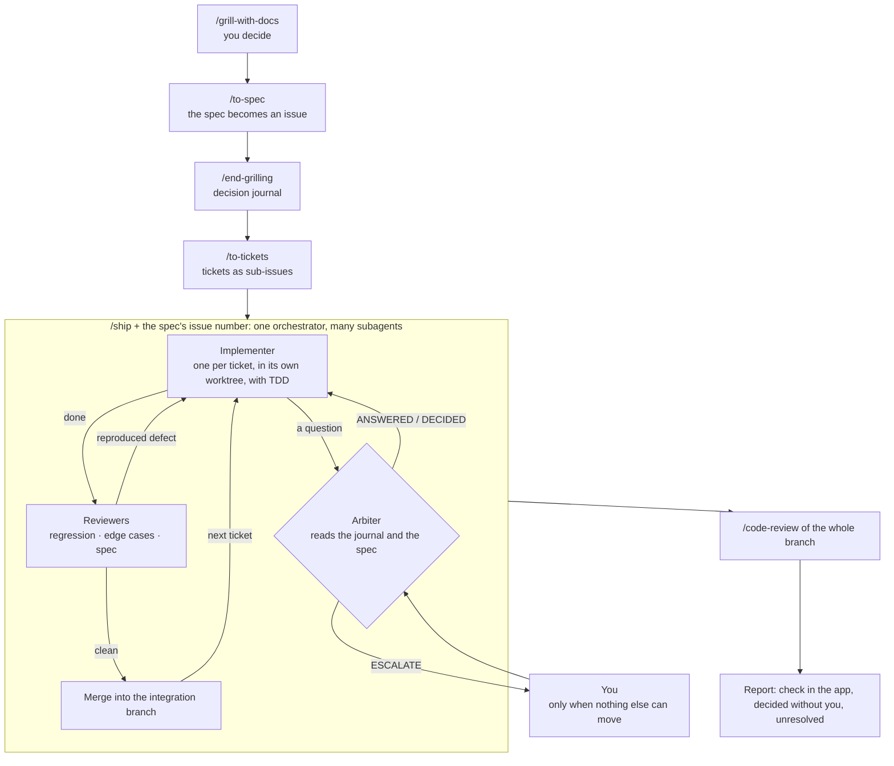

# skills

Personal Claude Code skills, installable with [`npx skills`](https://github.com/vercel-labs/skills).

| Skill | Description |
| --- | --- |
| `end-grilling` | Ends a grilling session: writes every decision the human made, in their own words, to the decision journal (outside the repo). |
| `ship` | Ships a spec's tickets on an integration branch: each ticket implemented, reviewed until clean, then merged. |
| `setup-ship` | Prepares a repo for the other two, or checks that it still is: delivery rules up to date and true, no spec, journal or skill committed. |

## Why these skills

They complement [Matt Pocock's](https://github.com/mattpocock/skills), which already cover grilling, the spec and the tickets. What was missing was unattended delivery: left alone, an implementing agent comes back with questions the human already answered during the grilling, or that are implementation details.

- **`end-grilling`** keeps those answers. The spec says what was decided; the **decision journal** also keeps how it was said, what was rejected and why, and what was pushed out of scope.
- **`ship`** delivers the spec on its own. When an agent asks a question, an **arbiter** answers it from the journal and the spec, in the human's place. Only the questions nothing settles reach the human.

## The flow



`/grill-with-docs`, `/to-spec`, `/to-tickets`, `/tdd` and `/code-review` are Matt Pocock's skills; `/end-grilling` and `/ship` are this repo's. `/setup-ship` is not part of the flow: it prepares the repo, once.

## How they work

### `end-grilling`

Run it at the end of the grilling, after `/to-spec`.

1. It rereads the conversation (or a past session, extracted by `extract-turns.py`).
2. It writes one entry per decision: what was asked, the answer verbatim, what it commits the feature to, the spec section it belongs to.
3. It shows the decisions missing from the spec and the contradictions, and fixes the spec if you accept.

The journal is never rewritten: a decision that overrides another is appended, and the earlier one is marked as superseded.

### `ship`

Run it with the spec's issue number: `/ship 47`. Everything else follows from it: the tickets are the sub-issues of #47, the journal is `decisions/47.md`, the integration branch is `ship/47`, the ticket branches are `ship/47-<ticket>`.

The orchestrator writes no code and reads no diff: it hands out work and routes reports.

| Role | What it does |
| --- | --- |
| Implementer | One per ticket, in its own worktree, with `/tdd`. It makes implementation choices on its own and lists them. |
| Arbiter | Answers questions the way the human already did. It escalates a question only if it can be asked without mentioning code, if the answer would be noticeable, and if nothing already said settles it. |
| Reviewers | Three per ticket, one per lens: regression, edge cases, spec compliance. A defect blocks only once reproduced. Three rounds at most. |
| Merger | Merges the clean ticket into the integration branch and reruns verification. |
| Checker | Loads whatever changed on screen in a real browser, in the sandbox. |

Nothing is ever committed on the main branch. At the end, a single message: the questions still open, what you need to check with your own eyes, what was decided without you, what is unresolved.

Skill files: `SKILL.md` (the orchestrator), `arbiter.md`, `reviewers.md`.

### `setup-ship`

Run it once per repo before the first `/ship`, then after a skills update or a change in the project's tooling. It follows the approach of `/setup-matt-pocock-skills`: explore, check, show, confirm, write.

| Check | What it catches |
| --- | --- |
| Shape | A template section that is missing, a leftover from an older template (journal path, branch naming, where specs live) |
| Standing | A line specific to a single delivery: a spec number, a branch name |
| True | A path that no longer exists, a command missing from the project's scripts and from the machine, a cited file that is gone |
| Clean tree | A committed spec, journal or third-party skill |
| Pointer | The missing "Delivery" entry in `CLAUDE.md` or `AGENTS.md` |

It first checks that your local copy is up to date with the remote, so it doesn't fix a file already fixed elsewhere. It checks that a command exists without running it: a full verification can take several minutes. It shows its findings and fixes, writes only after you agree, and commits nothing.

It is the one that writes `docs/agents/delivery.md` in a new repo, from `delivery-template.md`. If that file is missing, `/ship` stops and sends you here.

Skill files: `SKILL.md` (the four steps), `checks.md` (the checks), `delivery-template.md` (the template).

## What they expect from a project

- **A spec published as an issue**, and its tickets as sub-issues (`/to-spec`, `/to-tickets`).
- **`docs/agents/delivery.md`**: the project's delivery rules (verify command, sandbox, off-limits data and services, commit style). `/setup-ship` writes it and keeps it up to date. This file names no spec, ticket or branch: it holds for every delivery and is not rewritten from one spec to the next.
- **Matt Pocock's skills, all of them, at the version listed under [Compatibility](#compatibility)**, and `/setup-matt-pocock-skills` run once in the repo.

## Where things live

| What | Where | Why |
| --- | --- | --- |
| Spec, tickets | The issue tracker | Dated, closed once delivered, out of the agents' context |
| Decision journal | `~/.local/share/ship/<repo>/decisions/<n>.md`, `<n>` being the spec's issue number | Only `ship` reads it, for one delivery; a single copy, readable from every worktree |
| `ship` ledger (ticket status, verdicts) | `~/.local/share/ship/<repo>/ledger/<n>.md` | To resume after a compaction or a crash; `/tmp` is emptied at boot |
| A delivery's branches | `ship/<n>` and `ship/<n>-<ticket>` | Named after the spec, so nothing to choose |
| Delivery rules, glossary, ADRs | The repo | They describe the present or explain a lasting choice |

None of these locations is configured per project: the same convention applies everywhere.

## When not to use them

- **A small change, a single ticket.** `ship` starts one implementer and up to three reviewers per ticket: far more expensive than the change itself. Do it directly, or with `/implement`.
- **No grilling, so no journal.** The arbiter would have nothing to answer in your place: it would decide blindly or escalate everything.
- **A need that is still fuzzy.** `ship` executes a spec, it doesn't search for the path. To explore: `/prototype` or `/wayfinder`.
- **What can only be judged by eye**: how a page looks, a real phone, real data. `ship` files it under "check in the app", it doesn't validate it.
- **A project with no verify command and no sandbox.** Reviewers block only on a reproduced defect; with no way to run the product safely, they reproduce nothing.
- **If you want to review each diff as it lands.** The principle is the opposite: you review the integration branch at the end.
- **As a team, or from a cloud session.** The journal and the ledger live on your machine: a colleague or a remote session doesn't have them.

## Compatibility

These skills call Matt Pocock's, which evolve too. Rather than tracking which of his skills each one needs, each release is tested against one version of his whole set:

| This repo | Matt Pocock's skills |
| --- | --- |
| v1.0.0 | [v1.3.2](https://github.com/mattpocock/skills/releases/tag/v1.3.2) |

Install his main skills at that version:

```bash
npx skills add https://github.com/mattpocock/skills/tree/v1.3.2 -g
```

When asked which skills to install, select the **Mattpocock Skills** group; the **Other** group is not needed.

A newer version of his will probably work, but it is not tested.

## Installation

```bash
# All skills, user-level
npx skills add Schrubitteflau/skills -g

# A single skill
npx skills add Schrubitteflau/skills -g --skill ship
```

Update:

```bash
npx skills update -g
```

## Editing a skill

This repo is the source of truth. Edit here, push, then run `npx skills update -g`. Don't edit anything in `~/.claude/skills/` or `~/.agents/skills/`: the next update would overwrite it.

## Adding a skill

Create `skills/<name>/SKILL.md` (frontmatter `name` + `description`) with its supporting files next to it.
